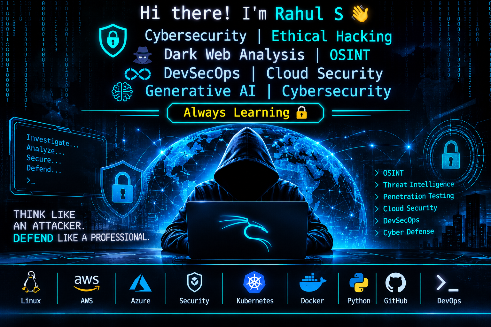

<!-- ========================= TYPING INTRO ========================= -->

  

<!-- ========================= PROFILE BANNER ========================= -->

  

# Hi, I'm Rahul Sharan 👋

### 🔐 Cybersecurity Enthusiast | CEH v12 Certified | Ethical Hacking | OSINT | Dark Web Intelligence | Cloud Security | DevSecOps

Passionate about cybersecurity, ethical hacking, threat intelligence, OSINT investigations, cloud security, and security automation. Exploring practical security techniques to identify vulnerabilities, analyze threats, secure infrastructure, and strengthen digital environments.

---

## 👨‍💻 About Me

- 🔐 Exploring Cybersecurity, Ethical Hacking & Vulnerability Assessment.
- 🌐 Learning OSINT, Dark Web Intelligence & Threat Analysis.
- 🕵️ Practicing reconnaissance, information gathering & security investigations.
- 💻 Strong foundation in Linux, Windows, Networking & System Administration.
- ☁️ Exploring AWS & Microsoft Azure Cloud Security.
- 🛡️ Practicing DevSecOps and integrating security into CI/CD pipelines.
- 🔍 Working with vulnerability assessment and penetration testing tools.
- 🤖 Exploring Generative AI for cybersecurity automation and analysis.
- 📚 CEH v12 Certified – EC-Council.
- 📝 Sharing cybersecurity tutorials, practical labs and technical knowledge on [Medium](https://medium.com/@rahulsharan512).

---

## 🔐 Core Cybersecurity Areas

**1. Ethical Hacking & Vulnerability Assessment**
- Vulnerability Assessment & Penetration Testing (VAPT)
- Network Reconnaissance & Enumeration
- Nmap Scanning & Service Detection
- Vulnerability Analysis & CVSS Scoring
- Metasploit Framework
- OWASP Top 10

**2. OSINT, Dark Web & Threat Intelligence**
- Open Source Intelligence (OSINT)
- Information Gathering & Reconnaissance
- Digital Footprint Analysis
- Threat Intelligence Fundamentals
- Dark Web Intelligence Fundamentals
- Security Investigation

**3. Network & Infrastructure Security**
- TCP/IP, DNS, DHCP, HTTP/HTTPS
- Network Scanning & Traffic Analysis
- Wireshark & Nmap
- Firewall & Network Security
- Linux & Windows Security
- Active Directory Fundamentals

**4. Cloud Security**
- AWS & Microsoft Azure
- Identity and Access Management (IAM)
- RBAC & Least Privilege
- Cloud Infrastructure Security
- Security Monitoring
- Cloud Misconfiguration Assessment

**5. Application Security & DevSecOps**
- OWASP ZAP
- Burp Suite Fundamentals
- Web Application Security Testing
- Docker & Kubernetes
- Jenkins & GitHub Actions
- CI/CD Security Integration
- SAST & DAST Fundamentals

**6. Security Operations & Monitoring**
- Wazuh SIEM/XDR
- Security Event Monitoring
- Log Analysis
- Incident Investigation
- Prometheus & Grafana
- Threat Detection Fundamentals

---

## 🛠️ Technical Skills & Tools

### 🔍 Cybersecurity & Ethical Hacking

`Kali Linux` `Parrot OS` `Nmap` `Metasploit` `Nessus` `OpenVAS` `Burp Suite` `OWASP ZAP` `Hydra` `Wireshark` `Autopsy`

### 🌐 OSINT & Threat Intelligence

`OSINT` `Reconnaissance` `Information Gathering` `Digital Footprinting` `Threat Analysis` `Dark Web Intelligence`

### 🐧 Operating Systems & Networking

`Linux` `Ubuntu` `RHEL` `Windows Server` `Active Directory` `DNS` `DHCP` `TCP/IP` `Firewall`

### ☁️ Cloud & Infrastructure

`AWS` `Microsoft Azure` `EC2` `S3` `IAM` `Azure VM` `Azure Storage` `Azure Networking`

### ⚙️ DevOps & DevSecOps

`Docker` `Kubernetes` `Terraform` `Ansible` `Jenkins` `Git` `GitHub Actions` `Packer` `ArgoCD`

### 📊 Monitoring & Security Operations

`Wazuh` `Grafana` `Prometheus` `Entuity` `Log Analysis` `Security Monitoring`

### 🤖 Programming & Automation

`Python` `Bash` `Shell Scripting` `YAML` `PowerShell`

---

## 🚀 Hands-on Projects & Practical Labs

### 🛡️ 1. Web Application Security Assessment
- Practicing web application security testing using OWASP ZAP.
- Exploring SQL Injection and Cross-Site Scripting (XSS).
- Understanding OWASP Top 10 vulnerabilities.
- Analyzing security findings and remediation techniques.

**Tools:** OWASP ZAP, Burp Suite, DVWA, Kali Linux.

### 🔍 2. Network Scanning & Vulnerability Assessment
- Performing host discovery and port scanning.
- Identifying open ports and running services.
- Practicing service and version detection.
- Exploring vulnerability assessment in controlled lab environments.

**Tools:** Nmap, Nessus, OpenVAS, Metasploit.

### 🌐 3. OSINT & Digital Footprint Investigation
- Exploring publicly available information.
- Practicing reconnaissance and information gathering.
- Understanding digital footprint analysis.
- Learning threat intelligence investigation techniques.

**Focus:** OSINT, Reconnaissance, Threat Intelligence.

### ☁️ 4. Cloud Security & Infrastructure Automation
- Exploring AWS and Azure infrastructure security.
- Practicing IAM and access control concepts.
- Automating cloud infrastructure using Terraform.
- Exploring secure cloud deployment practices.

**Tools:** AWS, Azure, Terraform, Ansible.

### 🛡️ 5. Security Monitoring with Wazuh
- Exploring SIEM/XDR architecture.
- Understanding Wazuh agents and server communication.
- Practicing endpoint monitoring and security event analysis.
- Learning centralized log collection and threat detection.

**Tools:** Wazuh, Linux, Windows, VMware.

### ⚙️ 6. DevSecOps & CI/CD Security
- Exploring security integration into CI/CD pipelines.
- Practicing automated security scanning.
- Understanding Docker image security.
- Exploring DevSecOps automation workflows.

**Tools:** GitHub Actions, Jenkins, Docker, OWASP ZAP.

---

## 📜 Certifications

- **Certified Ethical Hacker (CEH v12)** – EC-Council.

---

## 📊 Professional & Technical Highlights

- Hands-on experience with Linux, Windows and IT infrastructure.
- Practical exposure to AWS and Microsoft Azure.
- Familiarity with vulnerability assessment and penetration testing tools.
- Exploring OSINT and Dark Web Intelligence.
- Practicing security monitoring using Wazuh.
- Building DevOps and DevSecOps automation workflows.
- Interested in Cloud Security, Threat Intelligence and AI-powered security automation.

---

## 🎯 Currently Learning

- Advanced Ethical Hacking & VAPT.
- OSINT and Dark Web Intelligence.
- Threat Hunting & Threat Intelligence.
- Cloud Security – AWS & Azure.
- SIEM, SOC Operations & Incident Response.
- AI-driven Cybersecurity Automation.

---

## 📫 Connect With Me

- **GitHub:** https://github.com/rahuls512
- **LinkedIn:** https://www.linkedin.com/in/rahul-b-s-7019bb28b
- **Medium:** https://medium.com/@rahulsharan512

---

⭐ *Learning, Practicing, Exploring and Building in Cybersecurity.*

**"Think Like an Attacker. Defend Like a Professional."**
